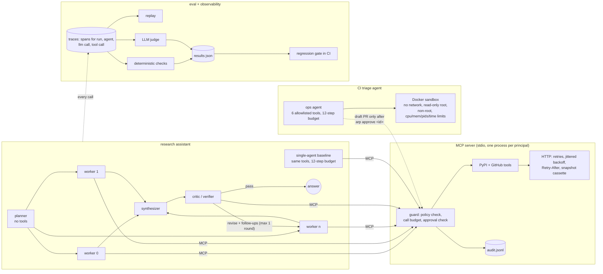

# agentic-research-platform

[](https://github.com/Samarateja0118/agentic-research-platform/actions/workflows/ci.yml)

A multi-agent research assistant, the MCP server its agents call, a sandboxed agent that triages failing CI and proposes patches, and the evaluation and observability harness wrapped around all of it. Python 3.11.

The point of the project is the harness as much as the agents. Every question in the eval set has a ground-truth answer computed from a frozen API snapshot, every run is traced and can be replayed byte for byte, and CI fails a pull request when a prompt change was not re-evaluated or lowers quality.

**Read this first: the measured numbers below come from a 4B local model, not Claude.** The container this was built in had no Claude API key, so every run used Qwen3-4B-Instruct-2507 (Q4_K_M, llama.cpp, 4 CPU cores) through the same provider-neutral interface the Claude backend uses. The Claude backend is implemented (`arp.llm.AnthropicLLM`, official SDK, manual tool loop) and a manual GitHub Action runs the same evals on Claude when an `ANTHROPIC_API_KEY` secret is set, but no Claude numbers are reported here because none were measured. Dollar figures are the local runs' token counts priced at Claude list prices, as a rough guide only (Qwen's tokenizer differs from Claude's).

## Architecture



| Component | What it does | Code |
|---|---|---|
| LLM layer | One neutral message format; backends for Claude (official SDK), any OpenAI-compatible server (llama.cpp), scripted test doubles | [`arp/llm.py`](arp/llm.py) |
| Multi-agent researcher | Planner splits the question into up to 4 independent sub-questions, workers run them in parallel with tools, a synthesizer writes the answer from findings plus raw tool output, a critic checks it against the evidence and can request one revision round with follow-up workers | [`arp/agents/research.py`](arp/agents/research.py) |
| Single-agent baseline | One tool loop with the same tools and a 12-step budget | same file |
| Tool loop | Parallel tool calls per turn, step budget with a forced final answer, identical-call dedupe | [`arp/agents/loop.py`](arp/agents/loop.py) |
| MCP server | 9 read tools (PyPI package/releases/version, GitHub repo/languages/dir/file/workflow runs/commits) and 1 write tool (draft PR), built on the `mcp` 2.x SDK | [`arp/mcp_server/server.py`](arp/mcp_server/server.py) |
| Permissions and audit | Per-principal tool allowlist and denylist, repo allowlist, per-session call budget, default deny; human approvals bound to a SHA-256 of the exact payload; JSONL audit log with secret redaction | [`arp/mcp_server/policy.py`](arp/mcp_server/policy.py), [`configs/policy.yaml`](configs/policy.yaml) |
| Upstream HTTP | Retries on timeouts, 408/425/429/5xx with full-jitter backoff, honours Retry-After, never retries 4xx or writes; record/replay cassette | [`arp/mcp_server/http.py`](arp/mcp_server/http.py) |
| Ops agent | Reads a failing CI log, investigates and edits a copy of the repo, runs tests in the sandbox, proposes a patch; one-shot baseline for comparison | [`arp/sandbox/`](arp/sandbox) |
| Tracing and replay | Nested spans (contextvars, so parallel workers nest correctly) with full requests and responses; replay re-runs the real orchestration code against a trace and reports the first divergent request | [`arp/obs/`](arp/obs) |
| Evals | Deterministic checks, LLM judge, paired bootstrap, comparison report, regression gate, rescore | [`arp/evals/`](arp/evals) |
| Eval data | 31 research questions + 6 harder ones, ground truth computed from the snapshot; 8 seeded bugs in a small library | [`evals/`](evals) |

## The eval sets

**Research questions** ([`evals/datasets/research.jsonl`](evals/datasets/research.jsonl), 31 questions). Lookups (6), multi-entity comparisons (11), specific versions (4), GitHub repo facts (7), and cross-source questions that read a file in a GitHub repo and then look something up on PyPI (3). Example: *"What version range of the mcp package does Samarateja0118/movie-mcp-server pin in requirements.txt, and does that range allow the latest mcp release on PyPI?"*

Ground truth is never typed by hand. [`scripts/build_research_set.py`](scripts/build_research_set.py) fetches the real PyPI and GitHub APIs, computes each expected answer, and records every response into [`evals/cassettes/`](evals/cassettes). Agents then run against that same snapshot, so the answers cannot drift as packages release new versions, and CI needs no network.

Each question has 1 to 7 deterministic checks: a value must appear as a whole token (`3.1` does not match `3.12`), a count must appear as a number or number word, the ANSWER line must name the winner first, or start with yes/no. A question passes only if every check passes. An LLM judge also grades each answer 1 to 5 against the reference.

**Harder set** ([`research-hard.jsonl`](evals/datasets/research-hard.jsonl), 6 questions), each about 4 to 6 entities, such as *"For each of numpy, pandas, polars, scipy, matplotlib and scikit-learn, how many releases were published in 2024, and which published the most?"* These were added because the main set turned out too easy to separate the two systems (see below).

**Seeded bugs** ([`evals/bugs/`](evals/bugs)). A 5-module invoicing library with 23 tests, and 8 one-line bugs: a wrong literal, banker's rounding instead of half-up, two off-by-ones, a missing clamp, tax before discount, a boundary check, case-sensitive CSV headers. Each bug fails 1 to 3 tests. The agent gets only the failing pytest output. A fix counts only if the full suite passes in the sandbox afterwards, run by the harness and not by the agent, and the agent cannot edit tests.

## Results

All runs: Qwen3-4B-Instruct-2507 Q4_K_M on 4 CPU cores, temperature 0, judge = the same model. Wall times include two runs sharing the model server, so read them as relative.

### Round 1, then fixing what the traces showed

Round 1 put the multi-agent system behind the single agent: 64% vs 81% of questions passing every check. Reading the traces showed five causes:

1. **Guessed versions.** Workers called `pypi_version` with a version number they made up ("fastapi 0.104.0") instead of asking for the latest release. The tool returned real data for that old version, so the answer looked grounded and was wrong.
2. **Counting a truncated list.** Asked for total releases, workers counted the 40-item `releases_newest_first` list instead of reading `total_releases` (SQLAlchemy "22 releases"; the truth is 335).
3. **Lossy hand-off.** Workers' prose summaries dropped facts the synthesizer then could not recover ("1 language, Python" for a repo with four).
4. **A critic that attacked the wrong fact.** On q08 the draft used a guessed starlette version. The critic instead disputed httpx's `>=3.8`, which came straight from `pypi_package`, and the revision turned a wrong answer into "insufficient evidence".
5. **Planner confused sources.** It asked a worker for the PyPI entry of a GitHub repository.

It also found two bugs in the eval itself: one yes/no check expected the wrong answer, and the "winner named first" check penalised answers that listed both values in question order.

Round 2 changes, in this order: tool descriptions moved into [`prompts/tools.yaml`](prompts/tools.yaml) and rewritten to say which tool answers what (shared by both systems); the synthesizer now gets the raw tool results as well as the workers' summaries; one-line additions to the planner, synthesizer, critic and single-agent prompts; the dataset fixes. These changed together, so round 2 does not attribute the gain to any single change.

| metric | single agent, round 1 | multi agent, round 1 | **single agent** | **multi agent** |
|---|---|---|---|---|
| pass rate (all checks) | 81% | 64% | **100%** | **94%** |
| checks passed | 87% | 81% | 100% | 98% |
| judge mean (1-5) | 4.55 | 4.35 | 4.87 | 4.90 |
| LLM calls / question | 2.1 | 7.7 | 2.2 | 7.4 |
| tool calls / question | 1.8 | 3.0 | 1.8 | 2.8 |
| input tokens / question | 3,554 | 10,740 | 3,771 | 11,510 |
| output tokens / question | 146 | 470 | 129 | 385 |
| wall time / question | 83 s | 146 s | 64 s | 123 s |
| $ / question at Claude Haiku 5.5 prices | $0.0004 | $0.0013 | $0.0004 | $0.0013 |
| $ / question at Claude Sonnet 5.5 prices | $0.0086 | $0.0262 | $0.0088 | $0.0269 |

Round 1 rows were rescored with the round 1 dataset after one checker fix (number words such as "four" now count as numbers); [`evals/results/history/`](evals/results/history) has them.

**Multi-agent vs single agent on the main set: no measurable difference in quality, about 3x the cost.** The paired difference in pass rate is -0.032, 95% bootstrap CI [-0.161, +0.065] over 31 questions. Questions here need at most 3 lookups, and a single agent that can issue parallel tool calls handles that fan-out itself in 2 model calls.

### Harder questions (5-6 entities)

| metric | single agent | multi agent (up to 4 workers) | multi agent, up to 6 workers (experiment) |
|---|---|---|---|
| pass rate (all checks) | **6 / 6** | 2 / 6 | 5 / 6 |
| checks passed | 100% | 70% | 97% |
| judge mean (1-5) | 5.0 | 3.5 | 5.0 |
| crashed runs | 0 | 1 | 0 |
| LLM calls / question | 2.0 | 13.0 | 16.7 |
| tool calls / question | 5.5 | 5.5 | 7.7 |
| input tokens / question | 4,592 | 23,201 | 32,094 |
| wall time / question | 88 s | 277 s | 331 s |
| $ / question at Claude Sonnet 5.5 prices | $0.012 | $0.054 | $0.071 |

The harder set was meant to give the multi-agent design its best case: more entities than one agent comfortably tracks. It went the other way, and the traces say why:

- **Coverage loss at the planner.** With a cap of 4 sub-questions and 6 entities, the planner grouped some entities and the grouped workers skipped some ("fastapi: not found in findings").
- **A worker overflowed its context and took the run down.** One worker that was handed three packages hit llama.cpp's 8,192-token slot limit (HTTP 400) and the exception failed the whole question. A single agent handled the same six lookups in one turn of parallel tool calls with 4.6k tokens in total.
- **A typo stopped at the permission layer.** A worker asked GitHub for `Samarateja018/rag-eval-system` (one digit missing). The MCP policy denied it as outside the repo allowlist, which is correct, and the worker reported the repo as "inaccessible" instead of retrying with the owner from the question.

The experiment column changes two things: a failed worker now returns "no findings" instead of failing the run (also merged into the main code, with a test), and the planner may use up to 6 workers ([`prompts/variants/wide_plan/`](prompts/variants/wide_plan), `ARP_MAX_SUBTASKS=6`). That lifted the multi-agent system to 5/6. The one miss: the requests release count, 158, was missing from the answer. On 6 questions none of these differences are statistically meaningful; they are reported for the failure modes, not the rates.

### The regression gate catches a bad prompt

To check the gate, [`prompts/variants/terse_worker/worker.md`](prompts/variants/terse_worker/worker.md) is a realistic cost-cutting edit: *"answer from what you already know when you are reasonably confident; call a tool only if you are unsure."*

```
$ arp gate --baseline evals/baselines/multi-qwen3-4b.json \
           --candidate evals/results/experiments/multi-qwen3-4b-terse-worker.json \
           --prompts-dir prompts/variants/terse_worker
pass rate 0.935 -> 0.871 (delta -0.065, 95% CI [-0.226, +0.097], n=31)
FAIL pass rate dropped by more than 0.05
judge mean 4.90 -> 4.58 (delta -0.32)
FAIL judge mean dropped by more than 0.3
newly failing: q10, q20, q21, q30; newly passing: q09, q27
tokens per question 11894 -> 9559 (-20%)
GATE: FAIL        (exit code 1)
```

Tool calls per question fell from 2.8 to 2.0 and the "version" category fell from 4/4 to 2/4: the worker answered "latest numpy" from memory. The gate's thresholds (5 points of pass rate, 0.3 judge points) are point estimates. With 31 questions the bootstrap interval for this drop still includes zero, which is the honest limit of a 31-question gate; it is tuned to be noisy rather than miss regressions.

The gate also fails when the results in the repo are stale: it hashes the prompt files (including the tool descriptions) and compares them with the hash recorded in the results, so editing a prompt without re-running the eval fails CI. Replay of round 1 traces through round 2 code shows the same thing from the other side: every one diverges at `planner#0`, because the tool descriptions in its request changed.

### Judge vs deterministic checks

The 4B judge disagreed with the checks on 4 of 62 round 2 answers, and it was the one in error on 3 of them: it marked a correct "mlb-mlops-pipeline was created first" answer as 2/5 after misreading the timestamps itself, scored a correct answer 3/5 because the reference listed percentages while the answer gave bytes, and gave 5/5 to an answer that left `tests` out of a directory listing. Pass/fail in this README is the deterministic checks; the judge is reported alongside. A self-judging 4B model is a weak judge, and this is the first thing to change with an API key.

### CI triage agent vs one-shot patch

| | ops agent (tool loop) | one-shot (whole repo in the prompt) |
|---|---|---|
| bugs fixed (full suite green, verified by the harness) | **5 / 8** | 3 / 8 |
| model calls / bug | 6.0 | 1 |
| input tokens / bug | 10,618 | 1,430 |
| edits rejected by guardrails | 0 | 4 (edit text not found exactly once, or malformed JSON) |
| wall time / bug | 228 s | 68 s |

Failures, from the traces: on b01 and b02 the agent named the right root cause (comma replaced with a dot; `ROUND_HALF_EVEN` instead of `ROUND_HALF_UP`) and then stopped with a prose explanation instead of making the edit; on b02 it ran the tests four times without changing anything in between. On b03 it rewrote `due_date`, which fixed the Saturday case and broke a different date test, then gave up. The harness's own final test run is what marks all three as failures; the agent's claims are not trusted. The one-shot baseline failed mostly on mechanics: it could not reproduce the exact text it wanted to replace.

The guardrails in the sandbox runs: tests are read-only to the agent, edits must match exactly once, paths cannot leave the workspace, and code only executes as `python -m pytest` inside a container with `--network none --read-only --cap-drop ALL --security-opt no-new-privileges --user 1000:1000 --memory 512m --cpus 1 --pids-limit 128` and a wall-clock timeout. A test in [`tests/test_sandbox.py`](tests/test_sandbox.py) runs code inside the sandbox that tries to open a socket and write to `/etc`, and asserts both fail.

Pushing is gated separately. The ops agent's only write path is the MCP tool `github_create_pull_request`, and the server refuses it until a human runs `arp approve <id>` for that exact payload. [`results/approval-gate-demo.txt`](results/approval-gate-demo.txt) shows the refusal, the policy denial for the research principal, and an approval of a different patch failing to unlock this one. No PR was opened by the agent during this work.

### Other measured behaviour

- Replay: all 62 round 2 traces replay through the current code with identical requests and answers (`arp replay ... --strict`, run in CI).
- Workers duplicated each other: 21 of 83 worker tool calls in the multi-agent runs repeated a call another worker had already made, in 14 of 31 runs, because workers also see the overall question and wander into their siblings' entities.
- The round 2 critic rarely objects: 1 revise verdict in 32 critic rounds, and it passed both wrong multi-agent answers. Round 1's critic objected more often and was wrong when it did. With this model the critic adds cost without adding accuracy.

## Running it

```bash
python3.11 -m venv .venv && . .venv/bin/activate && pip install -e '.[dev]'
pytest -q                                   # 31 tests; sandbox tests need the image below
docker build -t arp-sandbox:py311 -f docker/sandbox.Dockerfile docker

# a model: Claude, or any OpenAI-compatible server
export ANTHROPIC_API_KEY=...  ARP_LLM=claude:claude-haiku-5-5@low ARP_JUDGE=claude:claude-haiku-5-5@low
# or: llama.cpp with a GGUF in ./models, see docker-compose.yml, ARP_LLM=local

arp ask "Which requires a newer Python, fastapi or flask?" --system multi_agent
arp trace .arp/last-trace.jsonl --io        # span tree with model outputs and tool results
arp eval --system multi_agent --out evals/results/my-run.json
arp compare evals/results/single-qwen3-4b.json evals/results/my-run.json
arp gate --baseline evals/baselines/multi-qwen3-4b.json --candidate evals/results/my-run.json
arp ops --all --mode agent                  # 8 seeded bugs in the Docker sandbox
arp ops --bug b04 --open-pr                 # files an approval request; nothing is pushed without `arp approve`
```

`ARP_HTTP_MODE=replay` (the default in Docker and CI) answers every tool call from the snapshot and fails on anything not in it; `replay_or_record` fetches and records misses; `live` ignores the snapshot. GitHub tools need `GITHUB_TOKEN` in live mode.

## CI

[`ci.yml`](.github/workflows/ci.yml) runs ruff, then all tests including the Docker sandbox tests (it builds the sandbox image first). The `eval-gate` job runs no model: it rescores the committed answers with the current checks, replays every committed trace through the current orchestration code in strict mode, and runs the regression gate against [`evals/baselines/`](evals/baselines). A prompt change therefore has to come with new results, and those results must not regress. [`eval-claude.yml`](.github/workflows/eval-claude.yml) is a manual workflow that runs both systems on Claude when the repository has an `ANTHROPIC_API_KEY` secret.

## Limits

- **No Claude results.** Every number above is from a 4B local model. The Claude path is implemented and unit-tested at the message-format level, but has not been run against the API from this repo.
- **Small eval sets.** 31 + 6 research questions and 8 bugs. Confidence intervals are wide; the multi vs single comparison on the main set is not significant either way.
- **Self-judging.** The judge is the same 4B model, and it was demonstrably wrong on several answers (above).
- **Round 2 changed several things at once**, after looking at round 1 failures on the same questions. The round 2 numbers are therefore optimistic for unseen questions; there is no held-out split.
- **The questions are about package metadata and the author's own repos**, answerable through 9 narrow tools that return a few hundred tokens each. That favours a single agent with parallel tool calls. Tasks where each sub-question needs long documents or many tool steps, more than fit one context, are where splitting work should pay off; this repo does not test that.
- **The sandbox is a container, not a VM.** It shares the host kernel. The agent's own file edits happen on a host-side copy with path checks; only test execution is containerised.
- **The approval gate is file-based and local.** It proves the binding (approval = exact payload digest) but is not a multi-user approval service.
- **The research tools are read-only by design**, and the GitHub repo allowlist only covers `Samarateja0118/*`.
- **Not measured:** latency under concurrent users, prompt caching savings, behaviour with a Claude-sized context window.
